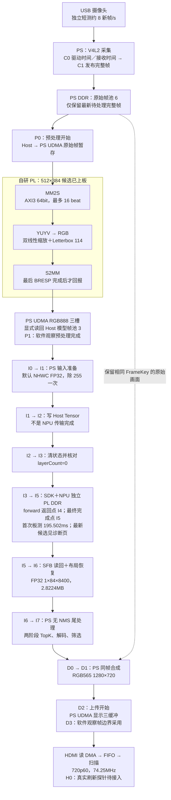
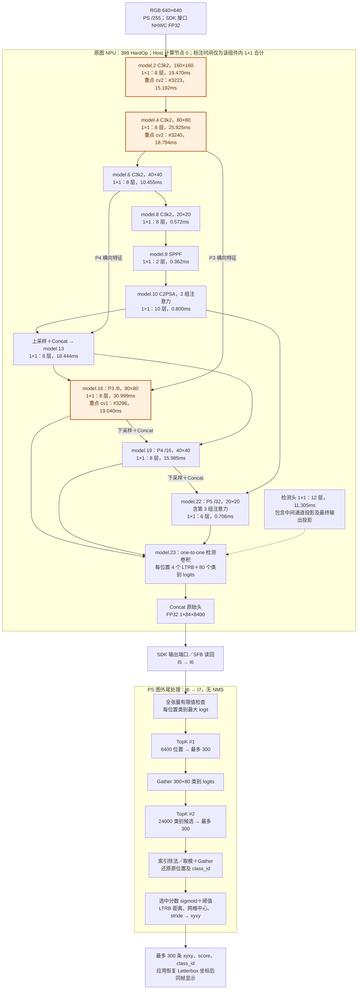
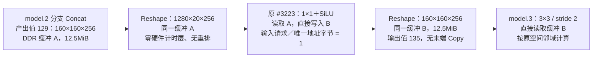
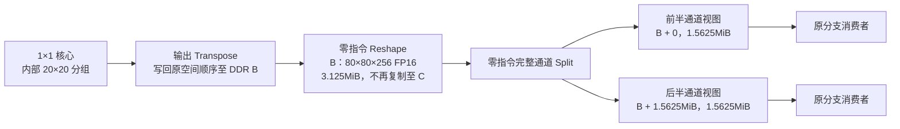

# 系统、算法与计时探针

512×384 混合图的文件回放见 [矩形部署](RECTANGULAR.md)，自研 PL 到 HDMI 采用的连续板测见
[实时闭环](RECTANGULAR-LIVE.md)。下文保留原始 FP16 图、对应的历史计时，以及在矩形闭环中沿用的软件探针。

系统总计时部分保留 2026-11-14 首次实际 NPU 回执；算法图已补入后续逐层诊断的 1×1 位置。
最新 OCM、逐层归因与布局实验统一见 [NPU-DIAGNOSTICS](NPU-DIAGNOSTICS.md)。首次性能原值见
[PERFORMANCE.md](PERFORMANCE.md) 与 [npu-board-r1.json](evidence/npu-board-r1.json)，
下表仅由该回执的第 2、3 次调用取均值。两次样本不是稳态或长期 FPS 验收。
板测范围为固定 RGB 文件、FP32 输入／FP16 计算；未包含摄像头、自研 PL 或 HDMI。

## 系统数据流

PS 普通 Host 帧池与 SDK `udma` 物理分配是不同对象。当前软件通过公开 `write/read`
接口显式传递数据；RGB888 从 UDMA 读回后才进入模型输入准备，不存在已验证的端到端零拷贝。
NPU 的独立 PL DDR 不与 PS UDMA 地址混用。HP2 仲裁保留原 AI 四路及返回 ID 契约，
旧摄像头已完成共享 HP2 的整机长测，满速输入下仍需测量实际竞争。

软件有三个执行线程：采集线程、SDK／视频控制所有者线程、同帧合成线程。
所有者在一次推理前可提交下一帧 PL 预处理，使硬件工作重叠；但它在 `infer_rgb()` 内等待时，
不执行 `poll_preprocess()` 或 `pump_display()`。因而当前软件观察到的预处理／显示耗时可能
包含约一轮推理的轮询延后，不能直接解释为 PL 或 HDMI 硬件忙碌时间。

各交接槽最多一个最新完整待处理项。池中的在途 DMA、推理、合成或扫描对象保持租约，不能覆盖。
旧待处理项被替换可以减小排队年龄，不能提高摄像头或 NPU 自身的服务率。
显示继续扫描上一张完整画面；重复扫描不增加新推理或新结果采用计数。

## 已有计时探针与补充位置

以下编号是本文对源码边界的命名，不表示存在同名寄存器。PS 时间采用同一单调时钟，
每条记录绑定启动代次和帧号。PL 硬件周期计数若后续实现，须锁存 tag、实际时钟和溢出状态，
不能直接与 PS 纳秒值相减。

| 探针／区间 | 精确含义 | 当前证据与限制 |
|---|---|---|
| C0 → C1 | 合法 V4L2 单调时间戳（不支持时使用接收时间）至应用发布完整帧 | 采集代码及独立相机短测存在；不是曝光开始或光学延迟 |
| P0 → P1 | 原始帧上传前，至安全完成响应被观察且 RGB888 读回 Host 后 | `Preprocess` 指标已接线；尚无自研 PL 板测，包含上传、配表、轮询延迟和读回 |
| I0 → I1 | `normalize_ns`，输入准备，默认 RGB888→NHWC FP32 | 实际 NPU 文件板测已有 |
| I1 → I2 | `input_write_ns`，公开 Host Tensor 写入 | 已有；不表示 NPU DDR 写入已完成 |
| I2 → I3 | `clear_ns`，状态清理及零完成计数核验 | 已有；不改变器件配置或算子数学 |
| I3 → I4 | `forward_ns`，进入至返回 `session.forward()` | 已有；可能含 SDK 提交、转换、传输及与硬件执行的重叠 |
| I4 → I5 | `final_wait_ns`，所有输出原生等待、ready、计数及回调核验 | 已有；是返回之后的剩余等待，不等于一层算子时间 |
| I5 → I6 | `output_read_ns`，`dump(SFB)` 与完整长度检查 | 已有；包含传输及布局处理，不是裸 DDR 带宽测量 |
| I6 → I7 | `postprocess_ns`，有限值检查、TopK、sigmoid 和解码 | 已有；I7 后才发布有效检测结果 |
| D0 → D1 | `Compose`，取检测包后至完整 RGB565 生成 | 实现已接线，有独立 CPU 基准；未在完整视频链路板测 |
| D2 → D3 | `Display`，显示上传开始至采用快照被软件观察 | 已接线但未完整板测；含提交、帧边界等待和轮询延后 |
| H0 | 实际 HDMI 刷新计数，与新结果采用计数分开 | 统计 API 存在，真实硬件来源尚未接入 |

`Inference` 阶段总计包括输入准备至尾处理结束；`Postprocess` 是其中的子区间，统计时不能重复相加。
文件测试中的 captured_ns 是测试输入时间，不能拿它作摄像头到显示延迟。

下一轮补充探针应优先分清以下边界，而不是增加更多无法解释的总计时：

1. **SDK 内部**：后续已保留 `enableTimeProfile(false)`，直接读取完成层的原生计时并独立复算原始计数，
   原图 399 个 HardOp 对应 322 个计时槽。尚待细分算子内部计算、搬运和停顿，而不是重新拆开连贯执行。
   原生计时是完成推理后采集；它没有给出 DDR 事务测量。结果见上述最新诊断页。
2. **PL 内部**：START 接受、首个／末个读响应、首个输出 beat、末个写响应、排空完成的锁存周期；
   补读写通道等待与流背压累计计数。当前 CSR 的已接收命令数、响应数和字节数不是这些周期探针。
3. **PS 传输与显示**：分开 UDMA 原始帧上传、RGB 读回、显示上传、硬件采用时刻与软件观察时刻。
   若移交显示轮询给独立线程，必须先建立不违反 SDK 单一所有者及停止排空契约的接口，不能直接并发访问设备。

## 实际调用时间分解

| 区间 | 第 2、3 次均值 ms | 占调用总时长 |
|---|---:|---:|
| I0→I1 输入准备 | 4.546 | 2.05% |
| I1→I2 Host 输入写入 | 3.338 | 1.50% |
| I2→I3 清状态 | 0.016 | 0.01% |
| I3→I4 forward 返回 | 9.069 | 4.08% |
| I4→I5 原生完成等待 | 186.432 | 83.87% |
| I5→I6 完整输出读回 | 12.460 | 5.61% |
| I6→I7 PS 尾处理 | 6.410 | 2.88% |
| 外层调用总计 | **222.281** | **100%** |

总计与分段和的微小差异来自边界取时及管理开销；原始纳秒记录保留。
I3→I5 合计 **195.502ms／87.95%**，是首次板测定位的主要瓶颈区间。
即使其它阶段全部免费，按该轮单在途调度和相同耗时也仅约 **5.12 次/s**。

## 矩形文件回放的探针路径

P3/P4/P5 格点为 64×48、32×24、16×12，网络原始头为 `1×84×4032`。
生成图含 428 HardOp、0 个 Host 计算节点。模型图外的归一化、检测候选筛选和坐标解码
由 PS 完成。与旧图相比，I1→I2 的程序内复制已经省去，SDK 仍负责提交和设备传输。
该轮整个文件调用约 **4.50 次/s**；后续布局实验的最新完整调用统一见诊断页。
这三次历史样本本身没有层归因；后续诊断已定位到 1×1 卷积，仍未测得 DDR 停顿比例。

相机当前约 8 新帧/s 是另一项独立限制。CPU 合成约 9.4ms 来自独立合成数据基准，
PL 预处理约 17ms 来自带 RAM 模型的 200MHz 仿真；两者都不能拼接成“已经测过的整机时间”。
完整物理时序尚未闭合，未上板的 RTL 不能直接承担上述推理路径。

## 算法架构与计算边界

[直接查看 1×1 标注图](figures/pointwise-architecture.png)。下方 Mermaid 保留可编辑结构。

原图共有 **86 个 1×1 卷积，原生执行时间合计 135.022ms**。橙色框含本轮优先处理的三个慢层；
三层合计约 53.027ms。图中省略部分 3×3 下采样细节，保留实际横向连接和检测分支；
每个框的毫秒数仅是其中 1×1 的合计，不能当作整个 C3k2／注意力模块耗时。
完整 86 层的名称、原生成 ID、形状及计时见 [位置映射](evidence/pointwise-location-r1.json)。
映射来自编译器 `ftmp_match.txt`，通过 adapted 输出 ID 回到原 ONNX 名称，不按形状推测。

| 本轮目标 | 算法中的准确位置 | 逻辑输入 → 输出 | 原图耗时 |
|---|---|---|---:|
| #3296 | Neck 的 P3 C3k2，`model.16/cv1/conv`，Concat 后的入口投影 | 80×80×1024 → 80×80×256 | 19.040ms |
| #3240 | Backbone 的 P3 C3k2，`model.4/cv2/conv`，分支汇合后的输出投影 | 80×80×512 → 80×80×512 | 18.794ms |
| #3223 | Backbone 的早期 C3k2，`model.2/cv2/conv`，分支汇合后的输出投影 | 160×160×256 → 160×160×256 | 15.192ms |

内部 1×1 的位置还包括 C3k2 的入口／出口和内部 bottleneck、SPPF 的压缩／融合、
注意力 QKV／输出投影及前馈通道投影、检测头通道投影；它们并非只在模型最后一层。
小空间分组与等价 Matmul 的实验决定见 [ADR_53](../../ADR/ADR_53.md)。
本图标注的是原始图位置与历史基线计时。三层分块／Matmul 的最新同板区域对比、重排成本及完整调用
见 [NPU 诊断](NPU-DIAGNOSTICS.md)，不将候选新生成 ID 混入原图位置。

### 160×160 点卷积的实际缓冲交接

后续布局候选将原 #3223 的空间平面解释为 1280×20，仍采用 NCHWc16 物理顺序、batch=1。
在 1×1 内部改变 H/W 不改变每个像素的通道点积；下游 3×3 必须恢复 160×160 的邻域解释。
两次恢复形状都只是视图，已经用生成指令、完整输出及板端实际地址分别核验。
具体地，原像素序号 `p = y×160 + x` 对应新坐标 `y' = p//20`、`x' = p%20`；
每个通道块内仍按同一个 p 读写，所以无需移动像素。改变的是编译器看到的分块形状，
不是检测模型的真实输入尺寸，也不是增加了新图像 batch。

“直接交接”证明中间没有额外副本；A/B 在这些实测中仍位于 NPU DDR，卷积写回和下游读入仍存在。
前序 Concat 也是零指令视图，分支生产者如何填充其区域仍服从生成器的完整存储规划。
不能据此声称跨算子片上驻留、PS/NPU 零拷贝或消除了全部 DDR 访问。
实际值 ID、chunk/offset、物理地址、消费者和指令层记录见
[最新复用／共享板测证据](evidence/pointwise-reuse-board-r4.json) 中的 `memory_flows`，覆盖全部十二个区域。

最新共享输出方案覆盖以下十二个原始点卷积；原始节点 ID 对应上方算法结构，候选内部 ID 由编译器重新分配。
相对此前十二层版本，只对仍有重复请求的六个核心改用 10×10；所有消费者仍看到原始完整空间形状：

| 算法位置 | 原节点 | 相邻布局的处理 |
|---|---|---|
| Backbone `model.2/cv2` | #3223 | 高宽视图；直接把恢复后的输出交给下一层卷积 |
| Backbone `model.4/cv1`、`cv2` | #3225、#3240 | 分别为 20×20／10×10；前者直接进入 Split，后者保留卷积＋Concat 分支 Copy |
| Backbone `model.6/cv2` | #3257 | 内部 10×10；卷积＋Concat 分支保留 Copy |
| Neck `model.13/cv1`、`cv2` | #3280、#3295 | 内部 10×10；前者直接进入 Split，后者保留 Upsample＋Concat 分支 Copy |
| Neck `model.16/cv1`、`cv2` | #3296、#3311 | 内部 20×20；分别直接进入 Split、三个只读卷积分支，均无末端 Copy |
| Neck `model.19/cv1`、`cv2` | #3313、#3328 | 内部 10×10；分别直接进入 Split、三个只读卷积分支，均无末端 Copy |
| P3 分类头的两层通道投影 | #3342、#3344 | 内部 20×20 分组；输出转置后直接交给唯一卷积消费者，取消 Copy |

以 #3296 输出为例，删除的是转置之后的副本，转置本身仍然执行。新图已经通过完整输出及实际存储核验：

两段必须覆盖同一 B 的完整范围，不能只验证首段。消费者共享其值／地址，B 的生命周期覆盖全部消费。
原生计时仍分别记录输入转置、核心、输出转置；零指令 Reshape／Split 没有独立硬件计时槽。
该图表达的交接只适用于已经核验的完整通道 Split；残留的三处 Concat 分支需要联合存储规划，不能照此删 Copy。

SiLU 已融合进点卷积，无需单独保留布局。普通 3×3、下采样和 Upsample 依赖空间邻域，
不能直接消费把展平像素分成内部 batch 的形状。Split/Concat 或多消费者也不代表永远不能直接交接；
须联合规划各分支输出位置、偏移和生命周期，再用全图视图检查与数值验证证明。当前已开放九处经验证的直接交接，
剩余三处输出 Copy 和真实转置是后续优化对象。决定与失败边界见 [ADR_54](../../ADR/ADR_54.md)。

原始部署 ONNX 中有 **166 Conv、6 MatMul、3 Softmax**。三组注意力的公共核心为
Q/K/V 投影 → QK 矩阵乘法 → 缩放 → Softmax → 与 V 矩阵乘法 → 投影及残差；
具体导出布局中注意力矩阵为 `[1,4,400,400]`。其中两组位于 `model.10`，第三组位于
`model.22/m.0/m.0.1/attn`，不能只将注意力归到 Backbone。
这些算子均由编译器纳入 NPU 图，没有为规避兼容问题删掉注意力或切换 one-to-many。

图中用组件层级表达结构，不按节点数代表计算量。399 个编译 HardOp、实际 1 个融合组及
322 个硬件完成层属于三种不同统计，均不能直接当成卷积数量或单层耗时。

## 哪些节点没有在 NPU 上执行

默认编译产物只有 `Input(op_id=0, @hostt)`、399 个 HardOp 和
`Output(op_id=457, @hostt)`。两个 Host 节点是图边界端口，不是神经网络计算回退。
三次实际推理的 NPU 回调各 1、Host 计算回调各 0，与编译分配一致。

| 位置／完整参考 ONNX 节点 | 当前执行位置与实现 |
|---|---|
| `/network/model.23/ReduceMax` | PS 每位置类别最大值；与全输出有限值检查合并为 NEON 扫描 |
| `model.23/TopK`、`TopK_1` | PS 两阶段 TopK；保持 one-to-one 选取语义，不进行 NMS |
| `model.23/GatherElements`、`GatherElements_1` 及末端 Gather | PS 根据入选索引取类别与坐标；实现采用直接索引，不解释执行 ONNX |
| 检测输出的 `model.23/Sigmoid` | PS 只对入选的最多 300 项计算；按 logit 排序利用其单调性，浮点饱和并列按等价候选验证 |
| 框解码的 Sub／Add／Mul | PS 使用网格中心 0.5 和 stride 8/16/32 从 LTRB 距离得到 xyxy |
| 末端 Div／Mod／Cast、Flatten／Reshape／Transpose 等 | PS 索引算术、循环与视图逻辑；固定形状常量不需要各自建立动态运行节点 |
| 模型前 `/255`、模型后阈值和 Letterbox 坐标还原、叠框 | 图外 PS 应用逻辑；阈值／坐标还原属于应用边界 |

上表以完整参考图的语义说明切分点，**不是 Icraft 不支持算子的黑名单**。
部署原始头 ONNX 仍有 8 个形状计算 Gather，它们与末端动态检测 Gather 不同；
最终图没有 Host 计算节点，不能仅凭同名 Gather 就判定 CPU 回退。
同样，部署图内 147 个 Sigmoid 主要参与 SiLU 等运算，仍在 NPU；被移到 PS 的是检测分数 sigmoid。
`reg_max=1` 无需 DFL，但注意力 Softmax 仍保留。完整参考和部署图均无 NonMaxSuppression。

将 TopK 移近 NPU 输出的潜在价值不止节省约 6.4ms CPU：原始输出为 2,822,400 字节，
若设备端直接输出固定 `[1,300,6]` FP32 则为 7,200 字节，逻辑载荷约小 392 倍。
这只是候选优化的载荷分析，未实现、未验证；即使理想消去首次板测的读回和尾处理约 18.87ms，
该轮 195.50ms 的 SDK／NPU 区间仍需独立优化。后续逐层诊断及布局收益见最新诊断页。

## 源码及原始图入口

- 运行时探针：`software/src/icraft_runtime.cpp` 的 `Impl::infer()`。
- 阶段事件与线程分工：`software/src/live_pipeline.cpp`。
- 物理暂存、读回和显示采用：`software/src/video_engine.cpp`、`icraft_video_io.cpp`。
- 两阶段 TopK 和解码：`software/src/postprocess.cpp`。
- 导出切分：`tools/export_model.py` 的 `Complete`、`Dense`，实际 one-to-one 分支不重写。
- 固定输入图审计：本机 `.local/yolo26-model-r2/{complete,dense}.graph.json`；实际 ONNX 同目录。
- 编译端口与分配：本机 `.local/yolo26-icraft-r3/generate.review.json` 及 `yolo26l_ZG.json`。
- profiling 行为说明：本机 `C:/Icraft/CLI v3.39.0/docs/demo/samples/xrt/timeProfile.html`。
