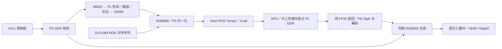

# 悟净 Lite YOLO26l 开发复盘

2026-11-15。悟净 Lite 使用同一份 YOLO26l 权重编成 512×384 静态图，在 600 秒多图回放中完成 18492 次完整检测，平均 30.82 FPS，每个一秒窗口完成 30 或 31 次。主干采用 batch=1 的无 NMS 推理。旧 USB 摄像头、自研 DMA 与 PL 预处理、NPU 和 720p60 HDMI 采用已接通，600 秒板测平均约 8.23 FPS。整机逐秒 30 FPS 未达标，实屏待人工观察。[矩形部署](RECTANGULAR.md) · [整机实测](RECTANGULAR-LIVE.md)

## 系统设计和实现范围

- **PS 层**负责 UVC 协商、有界帧交接、单线程 SDK 所有权、后处理、坐标还原、合成和计时。下游保留对应原始画面直到合成完成。共享板卡的测试启动和关闭均有独立证明。[系统架构与探针](ARCHITECTURE.md) · [软件维护](SDK.md)
- **PL 视频层**实现 AXI3 64bit 双向 DMA、颜色转换、双线性和 Letterbox，复用 HP2 仲裁及 HDMI 读链。DMA 按 16 beat 和 4KiB 边界拆突发，末端响应及 STOP 排空用于回收。HP2 竞争、预处理逐像素和两种 HDMI 扫描均有仿真记录。[DMA](DMA.md) · [预处理](PREPROCESS.md) · [SoC](SOC.md) · [显示](DISPLAY.md)
- **NPU 层**执行 Backbone、Neck、注意力和 one-to-one 原始头。首代 FP16 生成图有 399 个 HardOp，矩形 PSA 混合图有 428 个，两者 Host 计算节点均为 0。原始头之外的两阶段 TopK、分类 sigmoid、点位解码和结果过滤在 PS，允许同一位置出现多个类别。[算法图](ARCHITECTURE.md) · [算子兼容](MODEL.md)

## 性能演进

| 版本与输入 | 提交＋原生等待 | 完整调用 | 样本范围 |
|---|---:|---:|---|
| 640×640 FP16 首轮 | 195.50ms | 222.28ms | 同图 2 次普通样本 |
| 640×640 FP16 十二层分组 | 121.55ms | 148.50ms | 同图 12 次普通样本 |
| 640×640 PSA 混合精度 | 72.80ms | 99.62ms | 同图 12 次普通样本 |
| 640×640 PSA 四区域＋FP32 读回 | 65.74ms | 82.51ms | 同图 12 次普通样本 |
| 512×384 PSA，原运行时 | 27.66ms | 36.08ms | 同图 24 次普通样本 |
| 512×384 PSA，归一化与回放优化 | 27.94ms | 分段均值之和 32.372ms，P95 32.714ms | 600 秒 32 图循环，最慢秒 30 次 |

完整调用包含 RGB 输入准备、SDK 提交、原生等待、输出读回和 PS 无 NMS 解码。跨尺寸、精度及运行时的行用于定位迭代阶段。每个优化的单因素结论在各自同条件对照中确认。[首轮架构回执](ARCHITECTURE.md#实际调用时间分解) · [布局对照](NPU-DIAGNOSTICS.md#160160-消除转换与十二层扩展) · [混合精度对照](INT8.md#公开输出读取与选择性布局的同程序板测) · [矩形基线](RECTANGULAR.md#首轮板测)

矩形运行时将归一化数组直接绑定到 Host Tensor，省一次程序内拷贝。TopK 在扫描全部原始值之后，先排除所有类别均低于阈值的锚点，再进行两阶段选择。首轮 600 秒序列平均 30.485 FPS，其中四个测量秒各有 29 次。NEON FMA 对 256 种 RGB 字节输入逐位等价，归一化均值由 2.191ms 降至 1.478ms，平均升到 31.082 FPS。该轮记录过 1.925s 停顿，严格逐秒条件仍需处理抖动。[矩形运行时](RECTANGULAR.md#保持模型数据流的运行时优化)

最终版将预热张量写盘延后至 SDK 关闭，计时段不轮询板端。最长完整调用 73.538ms，约 45.853ms 落在 forward 区间，线程 CPU 时间约 30.964ms。此前 1.925s 停顿没有更细探针，测量中的文件写回和额外连接同时改变，根因仍未隔离。600 个逐秒窗口均过门槛，调用长尾和原生退出一并保留。[最终回放证据](evidence/rectangular-sequence-r4.json)

640×640 时 1×1 卷积累计约 135ms，早期三层最慢约 15～19ms。自动 OCM 策略已选 OPTION1。OPTION2／3 比该轮默认策略慢，主要热点仍在 DDR。20×20 分组提高像素块复用，统一 Matmul 方案引入重排，完整耗时变差。160×160 的一层后来改用等价空间视图，净省约 8.34ms。后续的完整视图和直接缓冲交接减少副本，跨上采样继续传播却新增 Concat 和下游重读。前后消费者必须共同纳入计时。[OCM 与逐层诊断](NPU-DIAGNOSTICS.md) · [布局及复制决策](../../ADR/ADR_54.md) · [二维传播对照](../../ADR/ADR_55.md)

观察 BOOT 在真实外部接口采集读返回、写使能字节和背压，验证 #3404→#3405 的权重预取。两层合计从 3.209216ms 降至 3.202901ms，完整调用从 83.215590ms 到 83.218894ms。指令中提前加载已成立，整体收益在本批不可确认。观察器没有 MPE 工作信号。#3405 输出通道切块增加输入重读，保留为退化对照。[访存时间线](MEMORY-TIMELINE.md) · [预取决策](../../ADR/ADR_57.md)

## 三个可迁移的工程决策

| 决策 | 依据与代价 |
|---|---|
| 固定 NPU 图内的原始 one-to-one 头 | 生成图没有 Host 回退。PS 的 80 类筛选和坐标变换可独立测试，代价是每个矩形帧要读回约 1.35MB 的完整 FP32 头。 |
| 保留实际安全完成作为所有权边界 | SDK 的输出等待和融合计数都通过才能改写 Host 输入，DMA 等最后响应、HDMI 等真正采用才能归还缓冲。未知完成状态保留资源并记录原因。 |
| 用顺序回放先确定主干能力 | 旧 UVC 当前限制新帧输入率。文件集可以验证时间、模型与内存完整性，给后续真实视频的时间预算提供基线。 |

## 量化、尺寸和数值

INT8 使用 PTQ，KLD 激活统计、权重按通道量化并保留 PSA／检测关键路径的 FP16。没有更新原权重。640 方形 PSA 的代理 mAP50–95 为 59.97%。512×384 在同一 32 图、218 个标注留出集上，FP32 为 58.685%，生成图 PSA 模拟为 58.557%。同一留出集的 640 方形 FP32 为 61.037%。另取板端回放中 31 张可配对的图，实板 PSA 为 59.923%，同子集模拟 59.556%，FP32 60.044%。各项均属于小型代理集。[PTQ 与消融](INT8.md) · [矩形板端代理集](evidence/rectangular-board-proxy-r2.json)

矩形图共 4032 个检测位置，始终保存完整 338688 个 FP32 输出。首轮单图板端对生成模拟的严格框差异门限失败，RMS 0.641，差异原值已保存。后续三处二维分组让两处 12.25 倍重读和一处 5.67 倍重读降至 1 倍，连同转置合计由 43.940MiB 降到 21.830MiB 指令请求。实图模拟的高分候选从 6 个变成 1 个，因此采用原图继续验证。字节覆盖、视图和完整数值共同决定候选能否上板。[布局证据](evidence/rectangular-layout-r1.json) · [矩形决策](../../ADR/ADR_59.md)

## 验收范围与未关闭事项

512×384 候选先通过完整布局布线及 CDC，再装入临时 BOOT。640×480 原始帧经 HP2 自研 DMA、
PL 颜色与缩放进入模型，实际框按同一帧的几何参数还原。应用在提交 DMA 前核对模型和硬件尺寸，
HDMI 以帧边界回执记录实际采用。[实时闭环](RECTANGULAR-LIVE.md) · [DMA 停止契约](DMA.md#停止顺序) · [显示帧管理](VIDEO.md)

| 子系统 | 已取得的证据 | 上线前的验证 |
|---|---|---|
| 静态模型 | ONNX 参考比对、Icraft 生成、ARM SDK 推理、完整输出留档 | 规模化标注集，以及模拟与实板数值差异追踪 |
| PS 运行时 | 旧相机与 PL、显示共同运行 600 秒，同帧和原生排空通过，设备分配归零 | 满速输入时的联合吞吐 |
| 自研 DMA 与图像预处理 | 物理时序签核，板端原图经 Q12 参考重建后与 PL 输出一致 | 满速输入时的共享 HP2 和 SDK 排程 |
| HDMI 720p60 | 扫描时序仿真、原 1080p 回归，实板采用缓冲与同帧合成逐字节一致 | 显示器锁定与实屏画面观察 |
| USB 相机 | VGA YUYV 协商 30 FPS，真实闭环平均 8.23 个新帧/s | 能持续送入 30 个新帧/s 的输入下完成 600 秒整机回归 |

发布记录需包含可追溯的源码／位流身份、完整物理验证、实际板测身份和实屏观察。详细缺口及受控恢复入口见下列记录。[SoC 物理进度](SOC.md) · [相机归因](CAMERA.md#第四批640480-帧率归因) · [困难记录](../../DIFFICULTIES.md) · [设备与恢复](RESUME.md)
