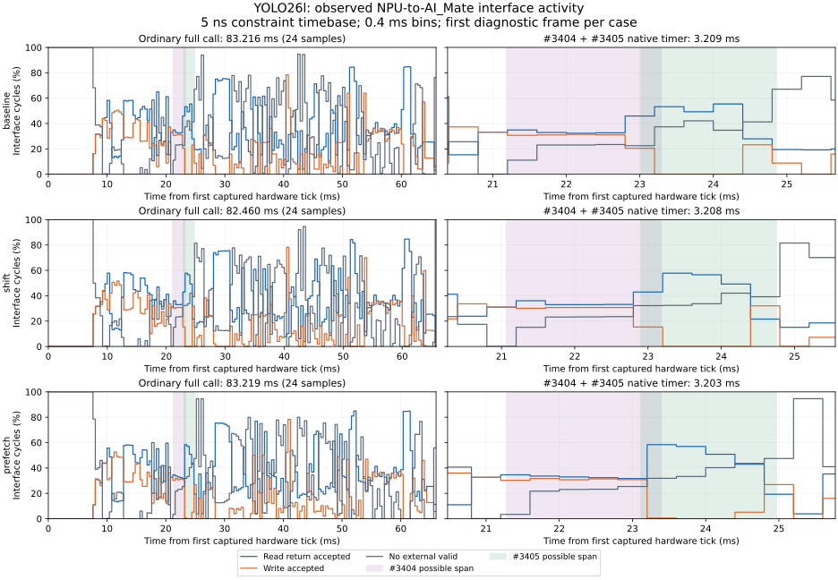

# 真实访存观测与权重调度

2026-11-14。已取得 NPU—AI_Mate 的真实接口时间线，完成基线、KLM 地址平移、跨层权重预取
三组共 90 次板测。预取仅有微小局部收益，没有可确认的完整调用加速；原 BOOT 已恢复，开发暂停。
结果见本页末尾，决定见 [ADR_57](../../ADR/ADR_57.md)。MPE 内部等待和物理 DDR 事务仍未直接测量。

## 固定基线与初步证据

使用 `.local/yolo26-int8-selective-block-r1`，JSON／RAW 身份沿用 `probe_contract.py` 的
`int8_psa_selective` 登记。完整调用约 82.511ms 的原始记录位于
`.local/yolo26-io-board-r1/selective_read`；本轮不把旧板测记作新实现验证。

前期最终指令与运行时分配对照：166 个卷积中 162 个主卷积核只请求一次，卷积核累计约
29.20MiB、重复约 2.87MiB；PL DDR 输入重复请求约 45.08MiB，含边界重读。
另有约 75.41MiB 输入重复请求来自 OCM。以上不是实测总线流量，也不是可直接消除的字节量。

## 采样接口

`package_probe.py --counter-trace --diagnostic-samples N` 只对最后 N 个诊断帧启用采样，
N 必须处于原有限帧数预算内，摄像头模式拒绝该选项。普通帧和模型字节不变。

`IcraftRuntime::arm_counter_trace()` 只为下一次调用置位。SDK 所有者在 forward 前、forward
返回后的原生等待区间以及完成后读取公开 `layerCount/rTileCount/wTileCount`，不启动第二线程
访问设备。固定预分配最多 512 条记录，轮询期间每组之间睡眠 200μs；实际间隔以时间戳为准。

每条记录包含 `begin_ns/end_ns`、`layer_before/layer_after` 和显式列 1..cols 的计数。
多个寄存器不是原子快照，不将计数差分归给单个瞬间。记录保存在 `npu-timers-<frame>.json`
的 `counter_timeline` 中；采样截断和观察开销都显式标记。

```powershell
python FPGA/yolo26_lite/tools/analyze_counter_timeline.py --timers <本批原始计时.json> --output <新报告.json>
```

分析器核验时序、层数、计数范围和记录容量，保留 uint32 模差及下降次数。字节带宽和
MPE 等待时间始终为 null，直到有对应的真实硬件观测；全零计数不转换为带宽空闲率。

## 本轮设备预检

`.local/yolo26-memory-r1/preflight-state-native.stdout`：共享锁取得成功，设备所有者为空，
启动仍为 `a81baed9-4517-4efd-b5bc-b7aebedd57e9`，由已关闭的 groups_read 批次消费。
本次检查没有 SDK 启动、BOOT 写入或重启。首次沙箱内 SSH 在本机信号管道创建阶段失败，
原生主机执行的只读预检成功；两份原始结果均保留。

ARM 构建范围为 `/root/yolo26-memory-build-20261114-r1`，共享锁覆盖子进程，
单线程、600MiB 编译地址空间上限，调用前核验可用内存；不运行 NPU。

## 验证状态

- 启动契约 13 项测试、时间线分析 4 项测试通过；合成计数仅用于测试解析器。
- ARM 编译成功，12 项 CPU／Host 测试全部通过；构建期间没有启动 NPU。
- 本轮 18 次推理、1 次 SDK、1 次正常重启，BOOT 写入和采集均为 0；全部原生关闭，分配归零。
- 首帧完整 705600 个 FP32 值与上一批 selective_read 逐位一致；18 帧均与首帧一致，运行时视图检查通过。
- #3404→#3405 预取、#3405 层内分块：待离线数值与地址证明，尚无可部署候选。

## 公开计数器实测

原始数据：`.local/yolo26-memory-board-r1/trace/returned`；汇总为同目录上一级的
`timings.json`、`numerical.json` 和三个 `npu-timers-*-timeline.json`。启动
`56206fd1-120a-4b64-b1d0-2abb6b860856` 已由本批消费，设备所有者为空，不能再次启动负载。
正常重启请求后 SSH 断开，原失败回执保留；后续实际新 boot_id 与空闲状态确认重启成功，未重复发请求。

普通稳态 12 帧完整调用均值 **82.596ms**，中位 82.621ms，范围 82.388–82.856ms；
forward＋原生等待均值 65.734ms。与原 82.511ms 基线相近，不能宣布优化收益。

3 个诊断帧分别有 218／219／218 组采样，观察跨度 65.80／66.20／65.82ms，未截断。
读取寄存器累计约 0.74–0.75ms；最大约 9.2–9.4ms 的采样空档对应同步 forward 内部，
不是已测的 DDR 空闲时间。列 1 的读写及列 2 的读计数恒为 0，列 2 写字段恒为
621945601；层计数仍正常推进至 361。因此这组公开寄存器没有提供可用的 Tile 活动观测。
列编号与计数字段的硬件映射仍须核实，不将非零常数解释为事务数。

**限制**：本模块取得真实层进度观测，不等同于真实 DDR 请求／返回及 MPE 等待时间线。
下一步应在 NPU—PL DDR 外部接口加被动握手监测，并独立确认可观测的计算状态；
不能把静态流量除以层耗时得到的数值写成实测带宽利用率。

## #3405 输出通道分块对照

`tools/split_conv_channels.py` 将原卷积的输出通道分为 128 或 64 通道一组。每支保留完整
输入归约、原权重存储字节、bias、SiLU 和对应量化系数，按原次序 Concat；无额外量化。
权重系数字符串按原文切片，不往返 float。原厂 Python 的 FP16 参数 buffer 导出失败，
改为独立 Params 浅克隆上的等字节 UInt8 视图；参与编译的 dtype 未改动。该 Host 失败与
早期缺少 NumPy 的准备失败保留在 `.local/yolo26-conv3405-o128-r1/r2`，均未上板。

128 通道候选 `.local/yolo26-conv3405-o128-r3`，64 通道候选 `-o64-r1`：
- 4 项变换边界测试通过，350／354 个序列化后参数逐字节核验通过。
- 各 3 组完整生成代码模拟输出均与原图逐位相同，生成视图检查通过。
- 各 18 次板测输出均与基线逐位相同；实际 Concat 输入是同一 chunk 的相邻完整片段，
  输出共享基址，零指令、零数据复制。全部 3 批共 54 次 NPU／3 次 SDK／3 次正常重启，
  没有 BOOT 写入或采集；每批正常关闭，分配归零，设备所有者为空。

| 方案 | 目标卷积合计 | 完整调用均值 | 输入静态请求 | 主权重静态请求 |
|---|---:|---:|---:|---:|
| 原图 | 1.547ms | 82.596ms | 6.525MiB | 3.094MiB（5.5 倍） |
| 两支 ×128 | 2.004ms | 82.767ms | 13.050MiB | 2.250MiB（4 倍） |
| 四支 ×64 | 2.794ms | 83.496ms | 26.100MiB | 0.563MiB（1 倍） |

静态请求不等同于实测 DDR 字节。实际分配和完整原值见
[本轮证据](evidence/memory-tile-r1.json)。普通调用使用相同 ARM ELF、原 BOOT、输入和 SDK。
每个方案仅一次启动批次、12 个普通稳态样本，不能把很小的整图差异当作严密统计结论；
目标区域的退化则清晰可见。**这两个候选均不选为性能版本。**

这是对“消除权重重复请求即可加速”的反例：64 通道方案确实让主权重只请求一次，但
每支再次读取完整输入，总输入请求增加 19.575MiB，目标层更慢。尚不能据此排除在
同一个硬算子内部共享输入、轮换 KLM 权重的方案；后者需要保留输入复用及指令依赖。

附加离线实验：`klmopt=2` 相对默认 3 没有改变 #3405 的请求量和指令类型计数。
公开 Python codegen 可以生成独立卷积，但返回后的公开 `ZgTask::getTasks()` 队列为空
（`.local/yolo26-task-access-r1`）。因此不能在返回后直接移动已生成任务来实现跨层预取；
需要生成期间的任务接口或可验证的指令调度。容量假设仍保留，不把接口限制说成硬件不可能。

最新板卡启动 `d4fae701-c0e2-4113-9df5-609b7fb8f157` 已由 o64 批消费并安全结束；
下一次功能启动仍需正常重启及重新核验。该三批仅覆盖输出通道分块；跨层预取的后续资格见下方记录。

## 跨层预取地址检查

`analyze_klm_handoff.py` 从原厂完整 TaskGen 区间检查 KLM 读写者，不重建日志中舍入的常数。
3 项边界测试通过。#3404 的 8 个 MPE 均使用低地址 8KiB；直接搬入 #3405 的首块会覆盖它。
将 #3405 **全部 KLM 读写**后移 256 个 U32 字（8192 字节）后，首块落在 8–26KiB，
最大地址 62KiB，在公开 Tile 模型的 64KiB 界限内，且与旧层所有读写包络无交集。
4 个初始广播任务合计逻辑载荷 72KiB；不能按 8 个目的 MPE 重复计算总线读取。

[地址证明](evidence/klm-handoff-r1.json) 明确 `deployable=false`：这只是容量／无覆盖证据，
不是已生成、已仿真或已板测的预取指令。仍需将后层参数正确绑定到前层、重建精确原生任务
依赖、删去被替代的初始加载，并保存完整数值回归。公共 codegen 返回后任务队列为空，
不能直接在返回值上重排任务；文本日志也不是无损的任务序列化。

## 被动总线分箱组件

`rtl/y26_npu_bus_bins.sv` 是独立单时钟观察组件，目标采样点为 `ps_ai_peripheral.sv` 中
NPU 与 AI_Mate 之间的 `pl_ar* / pl_r* / pl_aw* / pl_b*`，时钟 `pl_itf_clk`。观察端口
全部为输入，不向 NPU 或桥接器产生 ready、valid、地址或数据。该接口并非标准 AXI，
当前不推断地址单位、突发长度、请求返回对应或 MPE 状态。

组件保存每个有限时间箱的接口握手、valid 等待 ready、写字节使能总数、完全无 valid 周期
及首尾已接受 AR 原始地址。周期数使用本地 tick，不假设 SDK 标称频率就是实际总线频率。
记录汇出受阻时停止观测、置 overflow，并保留尚未消费的记录；该行为不停止硬件推理。
停止只关闭当前部分时间箱，最长箱为 1000000 周期、最多 4096 箱，配置在启动时固定。

记录每项 64 字节：32bit 字 0 为箱号，1 为本箱周期，2–3 为起始 64bit tick；
4–13 分别为 AR 握手、AR 背压、R 握手、R 背压、AW 握手、AW 背压、已接受写字节使能数、
B 握手、B 背压、无 valid 周期；14–15 为首尾 AR 地址。所有计数只描述观察接口，
不能把无 valid 周期直接称为 DDR 闲置或 MPE 等待。

`python FPGA/yolo26_lite/tools/run_sim.py --test npu_bus`：原厂 XSim 2018.3 的编译、展开、
仿真原生退出均为 0，30 项检查通过，包括周期边界、部分字节、同拍请求、背压、有限停止、
部分箱、记录不可覆盖及再次启动。最新源哈希与日志在 `build/npu_bus-latest.json`。
初版使用 SystemVerilog 保留字导致编译失败，原日志保留；改名后通过，随后平衡字节计数
加法树的版本再次通过；以下为后续采集链路状态。

### 片上记录区与控制接口

初版 `y26_npu_trace_store.sv` 保存最多 512 箱、每箱 64 字节，合计 32KiB；记录区不清零，
只发布本批已写入范围。采集活动期间拒绝读取数据；STOP 应答之后仍检查最终记录已提交。
`y26_npu_trace_csr.sv` 复用保持载荷的异步邮箱，GP 只读本地状态，因此 NPU 时钟停止
不会阻塞 GP 状态读取。两个邮箱端点使用同一全局复位来源，不随 SDK 单独重置其中一端。

新增独立地址 `0x400b6000`，只有 `YOLO26_NPU_TRACE` 定义时接入。偏移 0 为 NPT1 身份，
4 为 ABI；8／12 是周期／箱数，16 发命令，20 为记录字索引，24 为忙，28 为结果，
32／36 为发出／完成序号，40 为容量。命令 0／1／2／3 分别查询状态、开始、停止和读取。
软件必须等待忙清除及序号一致，超时不代表命令取消。观察器没有外部 DDR 写主机。

`run_sim.py --test npu_trace` 已通过编译、展开及仿真，共 381 次断言检查（含轮询断言），
覆盖异步时钟、目标时钟停顿、部分箱停止、范围检查和旧记录隔离。并非 381 个独立测试场景。
原网表追踪表明观察接口时钟来自既有 MIG `clk_pll_i`，约束周期 5ns；这不是物理频率实测。
新邮箱以目标时钟周期约束保持载荷及通知路径，显式排除旧例外范围，不增加 false path。

`prepare_npu_trace.py` 从合格 r7 依赖准备 `.local/nt1` 独立工程，保留原显示与 AI 四路。
整机综合原生退出 0，记录 RAM 已推导为块 RAM；综合阶段未加载实现约束，后续还须完整
setup／hold、CDC、DRC、JFM 适配与位流检查。当时尚无合格新 BOOT；最终资格见本页后续记录。

物理实现发现初版容量不足：`.local/nt1` 原生布局退出 1，`Place 30-640` 报告需要 531 个
RAMB18 等效位置，器件只有 530 个。保留该失败，不修改目标器件或增加例外。
记录区缩为 **256 箱、16KiB** 的 `.local/nt2` 通过联合仿真及综合，但布局仍需 531 个位置：
512bit 宽端口限制了 BRAM 的最小组织，减小深度没有减少实际块数。软件按读取到的容量选择箱宽：
256 箱时 80000 周期，在既有 5ns 约束下为
0.4ms／箱、102.4ms 总观察窗口。未把综合资源报告替代链接后的实际布局资源检查。

`nt3` 改用 32bit 深 RAM，接收完整一箱后用 16 拍写入全部字；最后一字提交后才增加
可读箱数。写入期间保持背压，观察器超载则显式置 overflow，仍只停止观测。开始、读取与关闭
状态都检查写入器已空闲。联合仿真对全部记录字建立记分板，包含故意超载，1895 次断言通过
（含轮询，不是 1895 个独立场景）。独立组件综合实际只需 **4 个 RAMB36**，原宽端口需要
7 个 RAMB36 加 1 个 RAMB18；这只是当时的组件结果，后续整机资格单独验证。

`qualify_npu_trace.py` 汇总完整原生时序／路由／DRC、保留功能、双向 CDC 及冻结输入身份；
`package_npu_trace_boot.py` 在实现与位流阶段完成后才运行原厂封装，逐字节检查非 PL 区域、
换序后的 PL 载荷及填充。3 项拒绝路径测试通过；解析器也在此前合格 r3 完整报告上通过。
测试覆盖新增 setup／hold 违例、旧例外对象或原值改变、DRC 汇总缺失详情及 BOOT 非 PL 改写。
该检查器实现时尚未执行新 BOOT 封装或写入。

临时维护入口 `trace_boot_board.py` 在同一共享锁下复用合格 FAT 实现，检查旧批次原生关闭、
零分配、设备所有者及进程身份，按独立次数完成安装／正常重启／读回备份回退。维护入口的
拒绝路径测试通过，覆盖失败原生退出、未排空、仍存活进程、其它所有者和过期启动；未启动 SDK。

`nt3` 已完成综合、优化、布局和布线，但最终门检原生退出 1：setup WNS **−0.261ns**、
TNS −4.276ns、35 个失败端点；hold WHS +0.022ns、THS 0。最差路径从写字节使能经
64bit popcount 加法树进入观察器 32bit 累加器。完整失败报告保留，不生成或部署该位流。

后续 `nt4` 将全部握手、地址、STOP、原始 tick 和写字节数同拍寄存，下一拍统一累计，
拆开 popcount 与宽累加进位链。窗口仍从 START 后第一拍开始，记录提交延后一拍；STOP
和有限结束要等最后事件累计后才关闭。组件 32 次断言和联合 RAM／CDC／CSR 的 1895 次断言
通过。复用 nt3 的有效路由 DCP **仅作为增量布局种子**，不继承其失败的时序资格；重新进行完整实现。

### 软件采集与分析

`NpuTraceController` 核验 ABI、容量及独占空闲，检查发出／完成序号；邮箱最多轮询 4096 次、
50ms。超时后封锁控制器，不重试不确定命令。STOP 后还要确认最后记录已写入 RAM，
读取时核验全部箱序、时间连续性及计数边界。测试包括序号回绕、目标时钟停顿、外部序号改变、
旧数据与非法配置隔离；析构没有 MMIO。该观察器只持有片上 RAM，不承担 NPU 完成证明。

有限文件包新增显式 `--bus-trace`，只对指定诊断帧启动。SDK 所有者在状态清零后、forward
之前启动，原生 wait 和融合完成计数通过后停止，记录读回放在诊断收集阶段。普通帧没有
新 CSR 访问；首次使用还核验 NPT1 身份。命令时间区间与读回开销保留，不能混入普通帧均值。

`analyze_bus_timeline.py` 输出实际接口握手／背压分箱和相对于 Host 的保守时间界限。
512bit 返回拍的接口载荷包含填充，不代表物理 DDR 事务字节；无 valid 周期不是 MPE 等待。
层计数只用于给出可能覆盖的完成层范围，不强行把一个箱归给某个算子。

本机 C++ 协议测试、14 项包契约测试、4 项分析器测试通过。最新 ARM 构建
`.local/yolo26-bus-build-r2/returned` 原生编译退出 0，13 项 CPU／Host 测试全部通过，
包括实际 ARM 上的采集协议测试。共享锁覆盖全生命周期，SDK／采集／BOOT／重启均为 0，
前后设备所有者为空。前一 r1 构建也通过，但仅测试旧清单 12 项；新实现使用 r2 ELF。

### 精确原生任务与 KLM 平移

`native_task_window.py` 在独立 Windows x64 编译进程内，临时替换公开 `tasks2Codes` 的导入
入口，处理后仍调用原函数并恢复入口；不修改 SDK DLL 文件，不运行设备。接口按公开头文件
及实际 Win64 入口核验，只支持当前 SDK release ABI。未修改任务的整图对照生成 JSON／RAW
与原基线逐字节相同。不能将此实验入口装入板端服务。

早期任务日志回调发生在指令生成之后，修改该处 Tile 没有改变 RAW；现在入口移到生成之前。
公开任务序列化包含进程地址，跨进程恢复出现访问异常；同进程恢复也不逐字节相同。因此不从
序列化流或舍入日志重建完整计算任务，而在原生对象存活期间使用公开 Tile getter 与 base 字段。
以上独立失败分别保存在 `.local/yolo26-task-stream-r1/r2`、`yolo26-task-shift-r1`，均未上板。

`shift_conv_klm.py` 先检查全部目标对象及地址，再将 #3405 的 **16480 个 KLM 读写 Tile**
统一后移 256 个 KLM 地址单元；本 INT8 Tile 每单元为 32 字节，不是 C++ 的 uint32_t。
任务顺序、常数及其它层不变。#3404 的 3232 个 KLM Tile 保持原址。
最大结束地址从 1728 变为 1984 单元，即 62KiB，前层低 8KiB 不被覆盖。
只允许已核实的 Assign、Boardcast、MatMul、MpeAcc、VpeMac、SegMac 类型。收窄类型守卫时
漏列 SegMac 的失败保留于 `yolo26-klmshift8k-r2`；补齐其 VLM 语义后 r3 与已验 r1 模型逐字节相同。

`qualify_klm_shift.py` 核对整图算子／存储描述和全部 **815 个参数对象**，只有 #3405 的
指令参数 v8863 改变。FP16 `Params` 不再次进入 Python buffer 构造重载，数学参数逐字节不变。
三组生成指令模拟各保存 **705600 个 FP32 值**，均与原混合图逐位一致、全部有限。
完整证据见 [KLM 平移离线资格](evidence/klmshift8k-r1.json)。固定模型已登记用于有限对照包。
**这验证了真实指令层面的地址平移；还没有提前加载权重，也没有板测收益。**

### 跨层预取完整候选

`prefetch_conv_weights.py` 现已生成 #3404→#3405 的真实预取候选，离线证据见
[完整资格](evidence/prefetch-prime-r6.json)、[精确整数 Tile 模板](evidence/prefetch-template-r1.json)。
模板固定原模型／SDK 身份，不保存原生指针；所有数学任务仍使用原生存活对象。

在 #3404 的任务 512 前插入四个广播，将合计 **72KiB 逻辑源载荷**提前装入八个 MPE 的
KLM `[8KiB,26KiB)`。#3405 原始四次大加载改成各 32 字节的暂存写入，逻辑源合计 **128 字节**，
两目的广播的 KLM 总写入量为 256 字节。它建立原生完成依赖，目标 `[0,32)` 不被后层数学任务读取。
不把这些逻辑载荷数当作实测物理 DDR 字节。

直接删去加载的独立实验报 `KLM.2.4 has no last inst`，再次进入失败原生函数又触发异常；
已保存原始错误、PID／创建时间，并结束该离线进程。正式工具在原生错误后保存证据并退出本编译
子进程，不再次进入失败 codegen。最初追加参数未重映射输出槽位，模拟报 DDR 范围错误；
补齐所有 200 个 ETM 输出 Tile 映射后通过。原失败均保留，均未上板。

维护工具生成 `.local/yolo26-prefetch-prime-r6`，JSON／RAW 与实验 r5 完全相同，因此复用其三组
完整指令模拟证据。每组 705600 个 FP32 值均与原选择性混合图逐位一致、全部有限。815 个参数对象
中仅指令 v8858／v8863 改变；816 个实际引用全部有相同源字节。检查原前层全部 3232 个及后层
全部 16480 个 KLM 访问，确认旧访问保留、平移完整、容量最大 62KiB、暂存区未被数学任务读取。
四项地址拒绝路径测试和固定模型包契约测试通过。候选仍为有限文件实验，尚未证明实际加速。

### 层边界与接口分箱的对齐

`analyze_prefetch.py` 对比同 ELF／输入／SDK／BOOT 的基线、仅 KLM 平移和真实预取候选，
分别保留完整调用、forward＋wait、#3404、#3405 和两层合计。普通计时排除前三帧预热及末尾
诊断帧；所有批次必须有完整有限输出、逐帧字节比较及原生关闭证据。

层计数读取与接口采样属于不同时间域。分析器用每次读取的起止时间约束层完成点，并保留
观察器 START 的主机时间不确定区间。事件数下界仅累加确定完整落入目标层的箱，上界累加
所有可能相交的箱；不把边界箱按时长比例分摊。没有完整内部箱时，下界为零是合法结果，
不是没有访存。三项边界测试通过；合成测试不充当板端数据，MPE 等待及物理 DDR 字节仍未知。

临时 BOOT 回退入口同时覆盖已成功关闭和失败后已证明关闭两种结果。后者还核对独立的
`native-failed-closed.json` 与 `native-exit.json`，保留失败原值，缺一不放行；仅退出进程仍不够。
关闭失败、剩余分配、错误启动身份及退出码不一致的拒绝路径已补测，维护本身不触发推理重试。

### 观察位流完整实现与封装

`.local/nt4` 综合、优化、布局、布线、最终报告、BIT 生成及 Procise 适配的原生退出码均为 0。
全设计 setup WNS **0.030ns**、hold WHS **0.022ns**，TNS／THS 均为零；100462 个可布线网全部完成。
原 AI 两处最小周期及原 GT 限定例外保持原对象、原值，没有新增时序或 DRC 豁免。
观察器最差输入 setup 0.429ns；整机 262/265 BRAM，观察器占 4 BRAM、696 LUT、2359 FF。

原生 CDC 报告包含两个三拍通知同步、一个三拍复位同步，以及 104 个保持载荷端点。
后者均属于已有握手邮箱结构，连同通知共 106 个端点的物理界限全部满足，没有未知 CDC 行。
完整资格和关键原始报告身份见 [硬件证据](evidence/npu-trace-hardware-r4.json)。

首次 BOOT 封装工具原生退出 0，但非 PL 对比发现镜像头中 9 字节的文件名变化，已保留失败包。
封装器改为复制本次适配 BIT 并沿用原 BOOT 的位流封装名称，不修改 BIT 或 BOOT 字节；
第二包 `.local/nt4/boot-package-r2/BOOT.BIN` 的非 PL 区域、填充完全相同，PL 载荷与本次 BIT 匹配。
新 BOOT SHA256 为 `6886da57e0adda66f481d051e0a610156a985ad4579a34d697dd359ebf27cbf9`。
这只是离线部署资格，板测和实际加速结论另记。

### 三组实板对照与暂停检查点

同一 ARM ELF、RGB 输入、SDK 和观察 BOOT；每组独立启动，30 次调用。普通性能使用第 3～26 帧
共 24 个样本，末尾 3 帧采集原生计时及接口时间线。各组均保存完整 705600 个 FP32 输出，后续每帧
全字节比较；三图及原 BOOT 基线逐位一致，全部有限。没有重新评价 mAP，也没有摄像头新帧验收。

| 方案 | 完整调用均值 ms | #3404 ms | #3405 ms | 两层合计 ms |
|---|---:|---:|---:|---:|
| 基线 | 83.215590 | 1.661099 | 1.548117 | 3.209216 |
| 仅 KLM 平移 | 82.460455 | 1.661269 | 1.546923 | 3.208192 |
| 跨层预取 | 83.218894 | 1.662123 | 1.540779 | 3.202901 |

预取的两层合计比基线少 **0.006315ms，约 0.20%**，比平移对照少 0.005291ms。
完整调用没有改善。平移对照的完整调用下降主要出现在 SDK forward 和 CPU／传输段，目标层
没有相应变化，不能将跨启动差异归因于地址平移。各组只有一次启动、三份逐层采样，均保留原始波动。
此候选保留为已通过数值及功能验证的实验，不替换性能基线；当前文件推理仍约 12 次／秒，未达到 30FPS。



蓝线为读返回接受周期占比，橙线为写接受周期占比，灰线为没有外部 valid 的周期占比。
紫／绿区域是 #3404／#3405 在主机读数不确定性下的可能范围，不是精确边界。
图取每组第一诊断帧，其余八份实际记录全部保留。0.4ms 箱不能直接分辨上述约 6μs 的收益；
局部耗时来自独立原生逐层计数，尚不能据此证明是哪一段计算与搬运发生了重叠。

真实接口证据：

- 九份采集均连续、冻结完成、无溢出；约 65.69～66.84ms，START 对齐不确定性约 11.79～13.38μs。
- 基线与平移每帧读返回载荷均为 **277446528 字节**，预取为 **277447680 字节**，增加 1152 字节；
  写使能有效字节数保持 145143844。接口载荷包含指令、填充及控制，不能直接改称物理 DDR 字节。
- 基线第一帧的读接受占比平均 32.89%，单箱最高 84.79%；AR 有效时约 38.35% 的周期被背压，
  R 有效时约 0.27% 被背压。访问具有明显阶段差异，可定位请求服务侧压力，不能以平均值判定整个 DDR 已饱和或闲置。
- 开始约 7.6ms 没有观察到外部请求，可与 SDK 调度区间进一步对齐；这不是已经测得的 MPE 空闲时间。

完整数据、身份及恢复证据见 [实板记录](evidence/prefetch-board-r1.json)。本机完整原始归档和
分析结果在 `.local/yolo26-prefetch-board-r1`；分析入口为 `analyze_prefetch.py`，绘图为 `plot_bus_timeline.py`。

下一轮讨论优先考虑减少中间激活搬运：编译图中 #3404 的 6.55MB 输出 v135 仅由 #3405 消费，
可研究条带／局部 Tile 在片上交接，以减少写回及再次读取。仍需证明局部存储容量、端口冲突、
3×3 邻域与量化激活步骤，不能直接删除外部存储。另一项是剩余 Transpose／Cast／Copy，
本次原生均值合计约 13.086ms。继续细分 #3405 时必须保留输入复用，避免重复 o128／o64 的退化。
以上是讨论候选，未开始新的实现或板测。

本批实际 3 次 SDK／90 次推理／9 次时间线／4 次正常重启，临时安装与回退各一次，采集为 0。
全部原生退出为 0、分配归零；最终已恢复原 BOOT 并完成新启动审计，当前设备状态见 [恢复入口](RESUME.md)。
